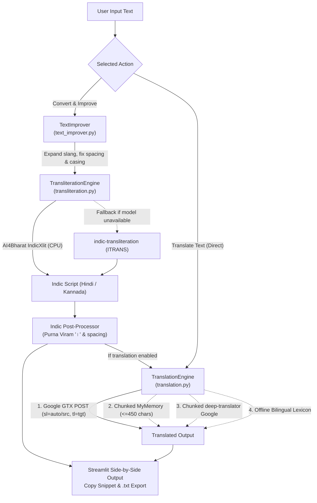

# LipiBridge

**AI-Powered Multilingual Writing Assistant**

[](https://www.python.org/)
[](https://streamlit.io/)
[](https://github.com/AI4Bharat/IndianNLP-Transliteration)
[](#12-license)

---

## 1. Project Overview and Objectives

**LipiBridge** is a lightweight, CPU-friendly multilingual writing assistant designed to bridge Romanized phonetic typing (such as Hinglish and Kanglish) with native Indian scripts and cross-language translation.

### Core Objectives
- **Roman-to-Indic Neural Transliteration**: Accurately convert Romanized Hindi (Hinglish) and Romanized Kannada into native Unicode Devanagari (`हिन्दी`) and Kannada (`ಕನ್ನಡ`) scripts using **AI4Bharat IndicXlit** on standard CPUs without GPU requirements.
- **Smart Sentence Improvement**: Clean informal chat abbreviations, irregular punctuation spacing, repeated punctuation marks, sentence capitalization, and Devanagari Purna Viram (`।`) formatting without changing original meaning.
- **Multilingual Translation with Auto-Detection**: Translate text across **English**, **Hindi**, **Kannada**, and **French**, featuring automatic source-language detection and paragraph-preserving chunking for long inputs.
- **Fault-Tolerant Offline Resilience**: Operate reliably even when external endpoints or neural weights are unavailable by using deterministic rule-based transliteration (`indic-transliteration`) and an offline bilingual phrase lexicon, while transparently indicating the active engine in the UI.

---

## 2. Features

- **Hinglish to Native Indian Script Transliteration** (`transliteration.py`):
  - **Hindi (Devanagari) Conversion**: e.g., `mera naam manjunath hai` $\rightarrow$ `मेरा नाम मंजुनाथ है`
  - **Kannada Script Conversion**: e.g., `namaskara` $\rightarrow$ `ನಮಸ್ಕಾರ`
  - **AI4Bharat IndicXlit Integration**: Runs `ai4bharat.transliteration.XlitEngine` (RNN v0.5 trained on the Aksharantar corpus) directly on CPU, with automatic fallback to `indic-transliteration` (ITRANS scheme).
- **English, Hindi, Kannada, and French Translation** (`translation.py`):
  - Bidirectional translation between `en`, `hi`, `kn`, and `fr`.
  - Multi-tier fault-tolerant pipeline: Google Translate GTX POST endpoint $\rightarrow$ chunked MyMemory (`deep-translator`) $\rightarrow$ chunked `GoogleTranslator` $\rightarrow$ offline bilingual lexicon (`OFFLINE_PAIR_DICTIONARY`).
- **Automatic Source-Language Detection** (`translation.py`):
  - Captures neural language detection when using `auto` online, and performs instant Unicode script detection (Devanagari `\u0900-\u097F` $\rightarrow$ `hi`, Kannada `\u0C80-\u0CFF` $\rightarrow$ `kn`) plus French diacritic/marker heuristics (`detect_language`) for offline and MyMemory fallback routing.
- **Smart Sentence Improvement & Text Preprocessing** (`text_improver.py`, `translation.py`):
  - Expands informal contractions (`plz` $\rightarrow$ `please`, `wid` $\rightarrow$ `with`, `msg` $\rightarrow$ `message`, `tnx` $\rightarrow$ `thanks`, etc.).
  - Fixes irregular whitespace around punctuation (`namaste , dost .` $\rightarrow$ `namaste, dost.`), collapses repeated marks (`???` $\rightarrow$ `?`, `!!!` $\rightarrow$ `!`), capitalizes sentence starts, and replaces Hindi declarative `.` with Purna Viram (`।`).
  - Preserves multi-paragraph line breaks and splits long inputs cleanly at sentence boundaries (`chunk_text_preserving_paragraphs`).
- **Interactive Streamlit Dashboard** (`app.py`):
  - Side-by-side input, improvement diff breakdown, converted script / translated text display, clipboard-ready code blocks, `.txt` download button, loading spinner, duplicate-request guard (`is_translating`), and clear engine status badges.

---

## 3. Technologies and Frameworks Used

| Layer | Technology / Library | Purpose |
| :--- | :--- | :--- |
| **Web UI & App Server** | Streamlit (`>=1.30.0`, tested on `1.67.0`) | Interactive dashboard, sidebar controls, and session management |
| **Runtime** | Python (`3.10+`, tested on `3.12.10`) | Core backend & NLP processing logic |
| **Deep Learning Engine** | PyTorch CPU (`torch>=2.0.0`) | CPU execution for AI4Bharat sequence-to-sequence models |
| **Neural Transliteration** | `ai4bharat-transliteration` (`>=1.1.3`), `pydload` | AI4Bharat IndicXlit RNN v0.5 trained on Aksharantar |
| **Phonetic Fallback** | `indic-transliteration` (`>=2.3.0`) | Pure-Python rule-based fallback transliteration |
| **Translation & HTTP** | `requests`, `deep-translator` (`>=1.11.0`) | Multi-tier Google GTX POST, MyMemory, and backup translation |
| **Testing & Evaluation** | `pytest` (`>=8.0.0`) | Automated unit testing and Levenshtein CER benchmarking |

---

## 4. System Architecture and Workflow

LipiBridge separates UI presentation (`app.py`) from modular NLP engines (`text_improver.py`, `transliteration.py`, `translation.py`):



---

## 5. Project Folder Structure

```text
LipiBridge/
│
├── app.py                     # Streamlit frontend & request orchestration
├── transliteration.py         # AI4Bharat IndicXlit engine + rule-based fallback
├── translation.py             # Multilingual translation, auto-detect, chunking & offline lexicon
├── text_improver.py           # Contraction expansion, punctuation & Purna Viram normalization
├── evaluate.py                # 35-case benchmark script (Levenshtein CER & accuracy)
├── requirements.txt           # Core Python dependencies
├── README.md                  # Project documentation
├── PROJECT_REPORT.md          # Academic lab report
├── .env.example               # Optional environment variable template
├── .gitignore                 # Git exclusion rules
│
├── data/
│   ├── test_cases.json        # 35 representative Hinglish/Kannada/edge-case inputs
│   └── evaluation_summary.json# Observed benchmark results
│
├── tests/
│   └── test_app.py            # 20 automated pytest unit tests
│
└── screenshots/
    └── README.md              # Screenshot placeholder index
```

---

## 6. Installation Instructions

### Prerequisites
- Python 3.10, 3.11, or 3.12 (Windows 10/11, Linux, or macOS)
- CPU-only environment (no NVIDIA GPU required)

### Setup Steps

1. **Clone the Repository**:
   ```bash
   git clone https://github.com/Manjulakkundi/LipiBridge.git
   cd LipiBridge
   ```

2. **Create and Activate a Virtual Environment**:
   - **Windows (PowerShell)**:
     ```powershell
     py -3.12 -m venv .venv
     .\.venv\Scripts\Activate.ps1
     ```
   - **Linux / macOS**:
     ```bash
     python3 -m venv .venv
     source .venv/bin/activate
     ```

3. **Install Dependencies**:
   ```bash
   pip install torch --index-url https://download.pytorch.org/whl/cpu
   pip install pydload streamlit indic-transliteration deep-translator requests pytest
   pip download --no-deps ai4bharat-transliteration
   pip install --no-deps ai4bharat_transliteration-*.whl
   ```
   > **Note (Windows CPU Compatibility):** Installing `ai4bharat-transliteration` directly via `pip` triggers a `fairseq` C++ wheel build failure on Windows. Installing with `--no-deps` alongside CPU PyTorch and `pydload` runs AI4Bharat's official RNN transliteration models smoothly on CPU.

---

## 7. Environment Variable Configuration

LipiBridge works out of the box **without any paid API keys or secret tokens**.

If you want to customize local runtime defaults, copy `.env.example` to `.env`:

```powershell
copy .env.example .env
```

Optional variables defined in [`.env.example`](.env.example):
- `PYTHONIOENCODING=utf-8` — Ensures Devanagari and Kannada output render cleanly in Windows PowerShell/terminal logs.
- `STREAMLIT_SERVER_PORT=8501` — Default local web server port.
- `STREAMLIT_SERVER_HEADLESS=false` — Controls headless browser launch on startup.

---

## 8. How to Run the Frontend and Backend

LipiBridge runs as a unified Streamlit application serving both the frontend interface and Python NLP backend:

```bash
python -m streamlit run app.py
```

Once started, open your browser at:
```text
http://localhost:8501
```

### Running Tests and Benchmarks
- **Unit Test Suite (20 tests)**:
  ```bash
  python -m pytest tests/test_app.py -v
  ```
- **35-Case Transliteration Benchmark**:
  ```bash
  python evaluate.py
  ```

---

## 9. Usage Instructions with Examples

### Mode A: Hinglish Transliteration & Smart Writing (`🚀 Convert & Improve`)
1. Select **Transliteration Script** (`Hindi` or `Kannada`) in the sidebar.
2. Enter Romanized text or click a **Quick Sample Input**.
3. Toggle **Smart Sentence Improvement** and/or **Include Translation in Convert**, then click **Convert & Improve**.

| Input | Polished Input | Transliterated Output | English Translation |
| :--- | :--- | :--- | :--- |
| `mera naam manjunath hai` | `Mera naam manjunath hai.` | `मेरा नाम मंजुनाथ है।` | `My name is Manjunath.` |
| `namaskara` | `Namaskara.` | `ನಮಸ್ಕಾರ.` | `Hello / Greetings` |
| `plz help me wid this work  ,  kya kar rahe ho???` | `Please help me with this work, kya kar rahe ho?` | `प्लीज हेल्प मी विद दिस वर्क, क्या कर रहे हो?` | `Please help me with this work, what are you doing?` |

### Mode B: Direct Multilingual Translation (`🌐 Translate Text`)
1. Choose **Source Language** (`Auto-Detect`, `English`, `Hindi`, `Kannada`, or `French`) and **Target Language** (`English`, `Hindi`, `Kannada`, or `French`).
2. Enter single sentences or multi-paragraph text and click **Translate Text**.

| Source $\rightarrow$ Target | Input | Output |
| :--- | :--- | :--- |
| `en → hi` | `Good morning, how are you today?` | `शुभ प्रभात तुम कैसे हो?` |
| `en → kn` | `Good morning, how are you today?` | `ಶುಭೋದಯ, ಇಂದು ಹೇಗಿದ್ದೀರಿ?` |
| `en → fr` | `Good morning, how are you today?` | `Bonjour, comment vas-tu aujourd'hui ?` |
| `auto → en` (French) | `Bonjour, comment allez-vous ?` | `Good morning, how are you doing ?` *(detected: `fr`)* |
| `kn → en` | `ನಮಸ್ಕಾರ, ಹೇಗಿದ್ದೀರಾ?` | `hi how are you` |

### Observed Verification Metrics
- **Automated Unit Tests (`pytest`)**: `20 / 20 passed`
- **35-Case Transliteration Benchmark (`evaluate.py`)**: `34 / 35 passed (97.14%)`, `91.19%` average character accuracy (`93.11%` Hindi, `87.51%` Kannada), `0.0881` average CER.

---

## 10. Screenshots

Add UI captures to the [`screenshots/`](screenshots/) directory using the filenames below:

- **Main Dashboard & Hinglish Transliteration**:
  `` *(placeholder)*
- **Hindi Transliteration & Smart Improvement**:
  `` *(placeholder)*
- **Kannada Transliteration**:
  `` *(placeholder)*
- **Multilingual Translation & Auto-Detection**:
  `` *(placeholder)*

---

## 11. Future Enhancements

- Quantized ONNX/CTranslate2 support for **IndicTrans2** to enable full-vocabulary offline neural translation on CPUs.
- Expansion to additional Indic languages (Tamil, Telugu, Marathi, Bengali, Gujarati).
- Real-time word-suggestion candidate dropdowns using top-$k$ beam outputs from IndicXlit.
- Support for exporting converted outputs as `.docx` and `.pdf` documents.

---

## 12. License

This project is licensed under the **MIT License**.

---

### References
- [AI4Bharat IndicXlit (IndianNLP-Transliteration)](https://github.com/AI4Bharat/IndianNLP-Transliteration)
- [AI4Bharat IndicTrans2](https://github.com/AI4Bharat/IndicTrans2)
- [indic-transliteration](https://github.com/indic-transliteration/indic_transliteration_py)
- [Streamlit Documentation](https://docs.streamlit.io)
